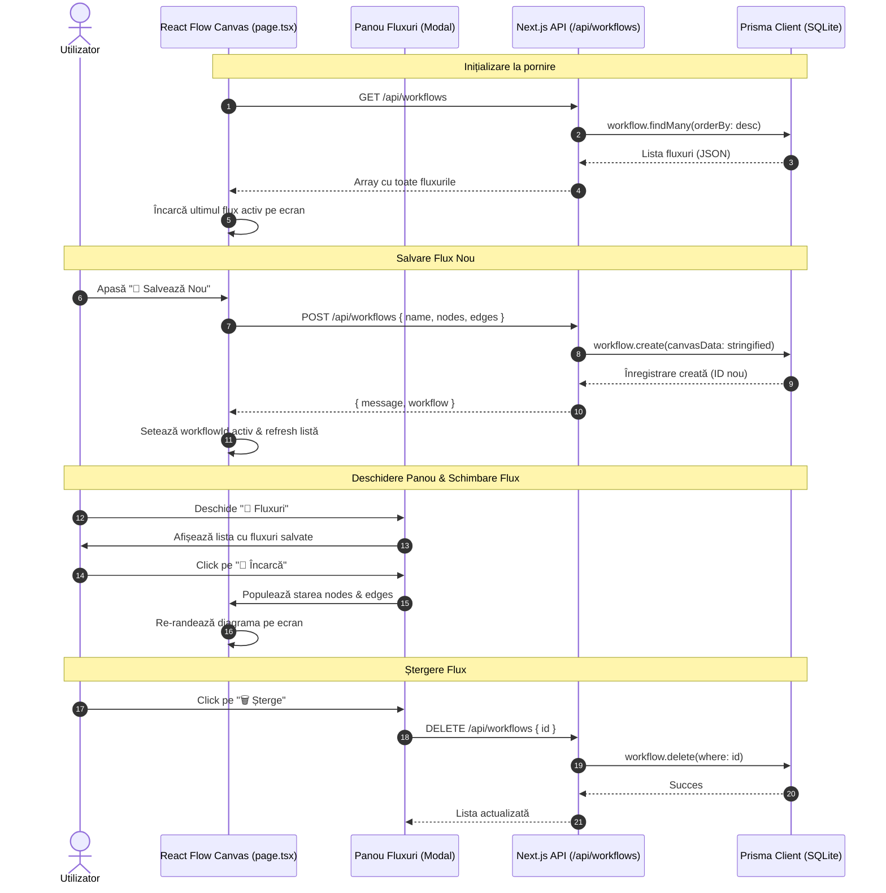
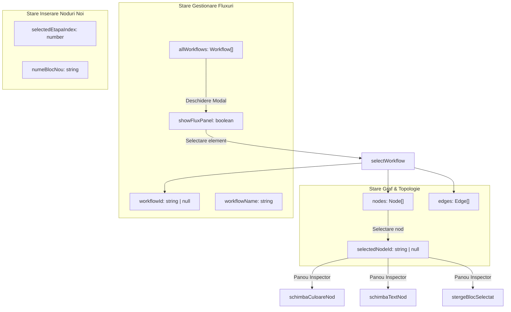

# ⚡ Cyber-Zap: Documentație Tehnică și Arhitectură

**Cyber-Zap** este o platformă vizuală interactivă de tip *Workflow & Device Flow Builder*, concepută pentru modelarea și gestionarea etapelor operaționale ale sistemelor inteligente, dispozitivelor hardware/IoT și automatizărilor de procese.

Aplicația folosește o arhitectură **Full-Stack Next.js 16** cu randare hibridă, un canvas grafic bazat pe **React Flow**, persistență prin **Prisma ORM** cu **SQLite**, și un design system modern orientat pe **Cyberpunk Glassmorphism**.

---

## 1. Arhitectura Sistemului (High-Level)

Sistemul este împărțit în trei niveluri principale:
1. **Frontend (Client-Side)**: Interfață reactivă bazată pe `React Flow` pentru manipularea grafurilor și panouri de control stilizate cu efecte de sticlă translucide.
2. **Backend (API Route Handlers)**: Endpoint-uri REST asincrone din Next.js App Router care validează și procesează cererile CRUD.
3. **Database Layer (Prisma ORM + SQLite)**: Modelare relațională cu stocare hibridă pentru serializarea topologiilor de graf.



---

## 2. Modelul de Date și Strategia de Stocare Hibridă

Pentru a stoca grafuri dinamice cu noduri și muchii, am implementat o arhitectură **Hibridă (Relational + Document)**:
- **Metadatele relaționale** (`id`, `name`, `createdAt`, `userId`) sunt stocate în coloane indexate tradiționale.
- **Topologia vizuală a grafului** (`nodes`, `edges`, coordonate X/Y, stiluri de culoare neon, etichete) este serializată într-un câmp unic `canvasData: String` (compatibil cu SQLite și extensibil la `JSONB` în PostgreSQL).

> [!TIP]
> **De ce modelul hibrid?**
> Un graf React Flow conține zeci de parametri variabili pentru fiecare nod (coordonate float, tipuri de conectori, culori personalizate, umbre CSS). Normalizarea într-o structură relațională pură cu 3 tabele (`Nodes`, `Edges`, `NodeStyles`) ar genera operațiuni costisitoare de tip JOIN la fiecare încărcare. Serializarea JSON asigură citirea și scrierea instantanee a întregului graf într-o singură interogare.

### Prisma Schema (`prisma/schema.prisma`)
```prisma
generator client {
  provider = "prisma-client-js"
}

datasource db {
  provider = "sqlite"
  url      = env("DATABASE_URL")
}

model User {
  id        Int        @id @default(autoincrement())
  email     String     @unique
  name      String
  workflows Workflow[] // Relație 1-la-N cu fluxurile
}

model Workflow {
  id          String   @id @default(uuid())
  name        String   @default("Untitled Zap")
  isPublished Boolean  @default(false)
  
  // Topologia completă a grafului serializată ca JSON String
  canvasData  String   
  
  userId      Int
  user        User     @relation(fields: [userId], references: [id])
  
  createdAt   DateTime @default(now())
  updatedAt   DateTime @updatedAt
}
```

---

## 3. Specificația API-ului (`/api/workflows`)

Toate operațiunile CRUD sunt implementate în Route Handler-ul Next.js din [src/app/api/workflows/route.ts](file:///c:/PORTABLE/dev/projects/FirstReact_project_react/NextJS_Tutorial/cyber-zap/src/app/api/workflows/route.ts):

| Metodă HTTP | Endpoint | Descriere | Payload Cerere | Răspuns (Status) |
|---|---|---|---|---|
| **GET** | `/api/workflows` | Returnează toate fluxurile utilizatorului curent, ordonate descrescător după data creării. | - | `200 OK`: `Array<Workflow>` |
| **POST** | `/api/workflows` | Creează un flux nou și stochează starea grafului în baza de date. | `{ name: string, nodes: Node[], edges: Edge[] }` | `201 Created`: `{ message, workflow }` |
| **PUT** | `/api/workflows` | Actualizează un flux existent pe baza identificatorului unic. | `{ id: string, name: string, nodes: Node[], edges: Edge[] }` | `200 OK`: `{ message }` |
| **DELETE** | `/api/workflows` | Șterge definitiv un flux din baza de date. | `{ id: string }` | `200 OK`: `{ message }` |

### Gestionarea automată a utilizatorului de test:
Fiecare cerere API verifică existența unui utilizator implicit (`test@cyberzap.com`). Dacă baza de date este proaspăt inițializată, utilizatorul este creat automat prin `prisma.user.create()` fără a necesita configurări manuale externe.

---

## 4. Arhitectura de Stare din Frontend (`page.tsx`)

Aplicația principală [src/app/page.tsx](file:///c:/PORTABLE/dev/projects/FirstReact_project_react/NextJS_Tutorial/cyber-zap/src/app/page.tsx) centralizează starea interactivă prin hook-uri React:



### Funcțiile Cheie ale Grafului:
- **`onConnect(connection)`**: Conectează două noduri, forțând stilul de conexiune animată Neon Magenta (`stroke: #ff00ff, strokeWidth: 2, animated: true`).
- **`onNodesDelete(nodesToDelete)`**: Curăță automat toate muchiile orfane conectate la nodurile eliminate, prevenind erorile de randare.
- **`schimbaCuloareNod(culoareNoua)`**: Recalculează dinamic stilul nodului:
  ```typescript
  style: {
    ...nod.style,
    color: culoareNoua,
    border: `1px solid ${culoareNoua}`,
    boxShadow: `0 0 10px ${culoareNoua}`
  }
  ```
- **`selectWorkflow(wf)`**: Încarcă instantaneu `canvasData` salvat în baza de date și reconfigurează starea React Flow.
- **`creeazaDiagramaNoua()`**: Resetează graful la un nod inițial curat (`Start Dispozitiv`) și comută starea pe `workflowId = null`.

---

## 5. Sistemul de Design (Cyberpunk Glassmorphism)

Stilizarea este implementată prin variabile CSS native definite în [src/app/globals.css](file:///c:/PORTABLE/dev/projects/FirstReact_project_react/NextJS_Tutorial/cyber-zap/src/app/globals.css):

### Paleta Cromatică
- **Background Abisal**: `#05050f`
- **Neon Cyan**: `#00f3ff` (acțiuni primare, titluri, noduri de start)
- **Neon Magenta**: `#ff00ff` (conexiuni animate, butoane de reset, procesare semnal)
- **Neon Green**: `#00ff88` (salvare, succes, stare `ACTIV`)
- **Neon Amber**: `#ffcc00` (calibrare hardware, avertismente, butoane actualizare)
- **Neon Coral**: `#ff0055` (ștergere noduri, fluxuri, butoane critice)

### Reguli de Stilizare Glassmorphism:
- **Panouri Translucide**: `background: rgba(20, 20, 35, 0.85)` sau `rgba(15, 15, 30, 0.96)`.
- **Blur de fundal**: `backdrop-filter: blur(12px)`.
- **Borduri Iluminate**: `border: 1px solid rgba(0, 243, 255, 0.4)`.
- **Efecte de Strălucire**: `box-shadow: 0 0 10px rgba(0, 243, 255, 0.3)`.

---

## 6. Asigurarea Calității și Validare (QA)

Aplicația este validată conform celor mai stricte standarde din ecosistemul Next.js:
1. **Compilare Turbopack**: Validată fără erori la rularea `npm run build`.
2. **Type Safety**: Verificare TypeScript strictă (`Finished TypeScript in 7.8s` fără erori de tipare).
3. **Persistență și Integritate**:
   - Ștergerea unui flux din modal reflectă schimbarea instantaneu în baza de date SQLite și în interfață.
   - Ștergerea nodului activ în timp ce panoul de editare este deschis resetează automat `selectedNodeId` la `null`.

---

## 7. Foaie de Parcurs (Roadmap)

1. **Autentificare cu NextAuth.js**:
   - Înlocuirea utilizatorului de test cu sesiuni reale bazate pe OAuth (GitHub/Google) sau e-mail/parolă.
2. **Export / Import Graf**:
   - Posibilitatea de a exporta diagrama curentă în fișier `.json` descărcabil sau ca imagine `.png`.
3. **Motor de Execuție (Workflow Runner)**:
   - Posibilitatea de a trimite semnale reale de test între noduri (ex: apeluri HTTP Webhook sau triggere simulate).
